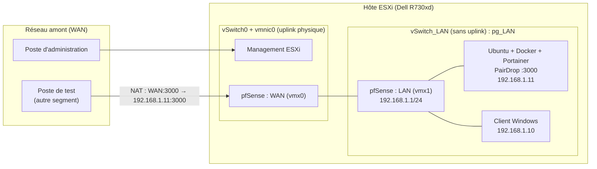

# Lab ESXi + pfSense : un mini-réseau d'entreprise virtualisé

Un hyperviseur **VMware ESXi** installé à distance sur un serveur Dell, un pare-feu **pfSense** qui sépare un réseau interne (LAN) du réseau amont (WAN), et un service web (**PairDrop**) hébergé dans **Docker**, géré avec **Portainer**, joignable par un nom de domaine interne et publié vers l'extérieur par une redirection de port.

> Labo monté pour pratiquer la virtualisation, le réseau et les conteneurs. Adresses, noms et identifiants sont anonymisés (voir [Anonymisation](#anonymisation)).

## Objectif du labo

Reproduire, en petit, ce qu'une PME fait pour héberger un service interne :

1. **Installer un hyperviseur** sur du matériel physique, sans écran ni clé USB, grâce à la console distante (iDRAC).
2. **Isoler un réseau privé** derrière un pare-feu : les machines du LAN n'ont pas d'uplink physique, tout passe par pfSense.
3. **Déployer un service conteneurisé** (Docker) avec une administration graphique (Portainer), des données persistantes (volume nommé) et un réseau Docker dédié.
4. **Nommer le service** avec un domaine fictif résolu par le DNS interne de pfSense.
5. **Publier le service** vers l'extérieur avec une règle NAT (port forward) et prouver l'accès depuis le WAN.

## Architecture

L'astuce du montage : une **seule carte réseau physique** pour tout l'hôte. Le WAN de pfSense partage donc `vSwitch0` avec la gestion d'ESXi, tandis que le LAN vit sur un second vSwitch **sans uplink**, totalement isolé du monde physique.

## Composants

| Rôle | Technologie | Détail |
|---|---|---|
| Serveur physique | Dell PowerEdge R730xd, iDRAC8 | Console virtuelle et montage d'ISO à distance |
| Hyperviseur | VMware ESXi 8.0 U3 | Host Client web, datastore VMFS6 |
| Pare-feu / routeur | pfSense CE 2.7.2 | WAN en DHCP, LAN 192.168.1.1/24, DHCP, DNS Resolver, NAT |
| Serveur d'applications | Ubuntu Server LTS | Docker, Docker Compose v2 |
| Administration conteneurs | Portainer CE | Installé en ligne de commande, stack déployé via l'interface |
| Application | PairDrop | Partage de fichiers local, port 3000 |
| Client de test | Windows 10 | Sur `pg_LAN`, sert à valider DNS et accès web |

## Étapes

| # | Page | Ce qu'on y apprend |
|---|---|---|
| 1 | [ESXi sur Dell via iDRAC](docs/01-esxi-idrac.md) | Boot distant sur ISO, installation de l'hyperviseur |
| 2 | [Datastore et validation de l'hôte](docs/02-datastore-et-hote.md) | Stockage VMFS, vérification matérielle |
| 3 | [pfSense : réseau virtuel et pare-feu](docs/03-pfsense.md) | vSwitch sans uplink, VM à deux cartes, WAN/LAN, client Windows |
| 4 | [Ubuntu, Docker, Portainer, PairDrop](docs/04-ubuntu-docker-portainer.md) | Conteneurs, volumes nommés, réseau externe |
| 5 | [Domaine fictif et client Windows](docs/05-dns-et-client-windows.md) | Host Override du DNS Resolver |
| 6 | [Port forward et accès depuis le WAN](docs/06-port-forward.md) | NAT, règle de filtrage associée, test externe |
| + | [Difficultés rencontrées](docs/07-difficultes.md) | Sous-réseaux, bannissement, port, bogons |

Les fichiers de configuration sont dans [`configs/`](configs/).

## Ce que j'en retiens

- Un **masque de sous-réseau** se lit avant de supposer : un `/21` n'est pas un `/24`, et une plage d'adresses réservée peut appartenir au même réseau que l'hôte.
- Un **nom DNS ne résout pas un port** : `pairdrop.lab.example` mène à une machine, pas à `:3000`.
- Un pare-feu a des **réglages par défaut protecteurs** (blocage des réseaux privés et bogons sur le WAN) qui deviennent un obstacle dans un lab où le WAN est lui-même privé.
- Un volume Docker **nommé** et un réseau **externe** rendent un stack reproductible, sans dépendre d'un chemin sur l'hôte.

## Pistes d'amélioration

- Mettre le service derrière un reverse proxy avec HTTPS (Caddy, Traefik, Nginx Proxy Manager).
- Restreindre la règle NAT à une adresse source précise plutôt qu'à `*`.
- Remplacer les mots de passe par défaut, activer l'authentification forte et sauvegarder la configuration pfSense.
- Automatiser le déploiement (compose versionné, Ansible).

## Anonymisation

Ce dépôt a été nettoyé avant publication :

- Noms, noms d'hôtes, numéro de série du serveur et identifiants Netgate retirés.
- Adresses IP du réseau amont remplacées par des gabarits (`172.16.X.Y`) ; seules les adresses privées génériques du lab (`192.168.1.x`) sont conservées.
- Domaine remplacé par `lab.example` (domaine réservé à la documentation).
- Mots de passe et jetons absents du texte, masqués par un aplat noir dans les captures.

## Avertissement

Environnement de test : les réglages (redirection sans filtre de source, absence de HTTPS, désactivation du blocage des réseaux privés sur le WAN) ne sont pas adaptés à un réseau exposé à Internet.
