# Étape 1 : installer ESXi à distance avec l'iDRAC

[← Retour au sommaire](../README.md) · [Étape suivante →](02-datastore-et-hote.md)

## Objectif

Installer VMware ESXi sur un serveur sans y toucher physiquement. L'**iDRAC** (le contrôleur de gestion intégré de Dell) fournit une console virtuelle (écran, clavier, souris) et permet de **monter une ISO** comme si c'était un lecteur optique branché sur le serveur.

## Déroulé

1. **Connexion à l'iDRAC** par son interface web (HTTPS, adresse du réseau de gestion) avec le compte administrateur.
   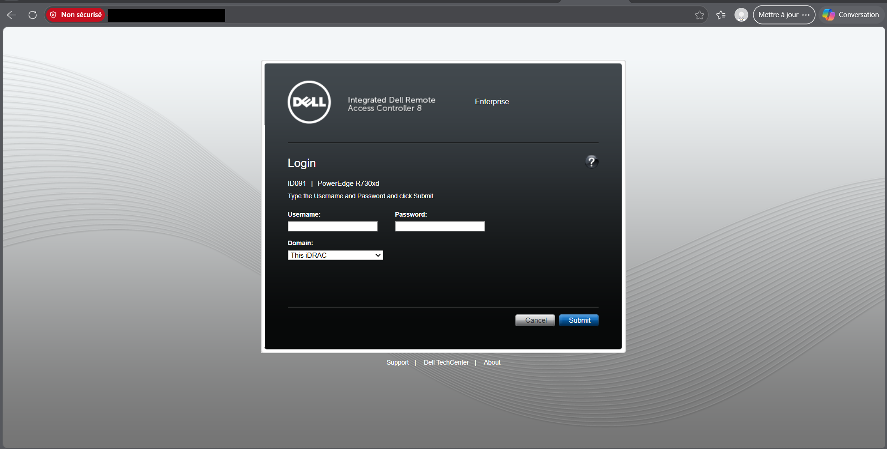
   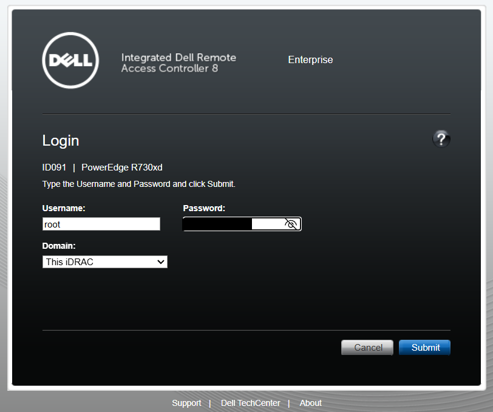

2. **Vérifier le serveur** dans *System Summary* : modèle R730xd, état général, aperçu de la console.
   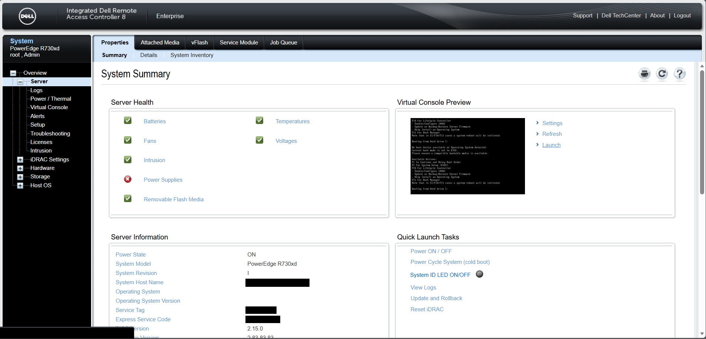

3. **Ouvrir la console virtuelle.** Le serveur n'a aucun système installé et boucle sur « No boot device available ».
   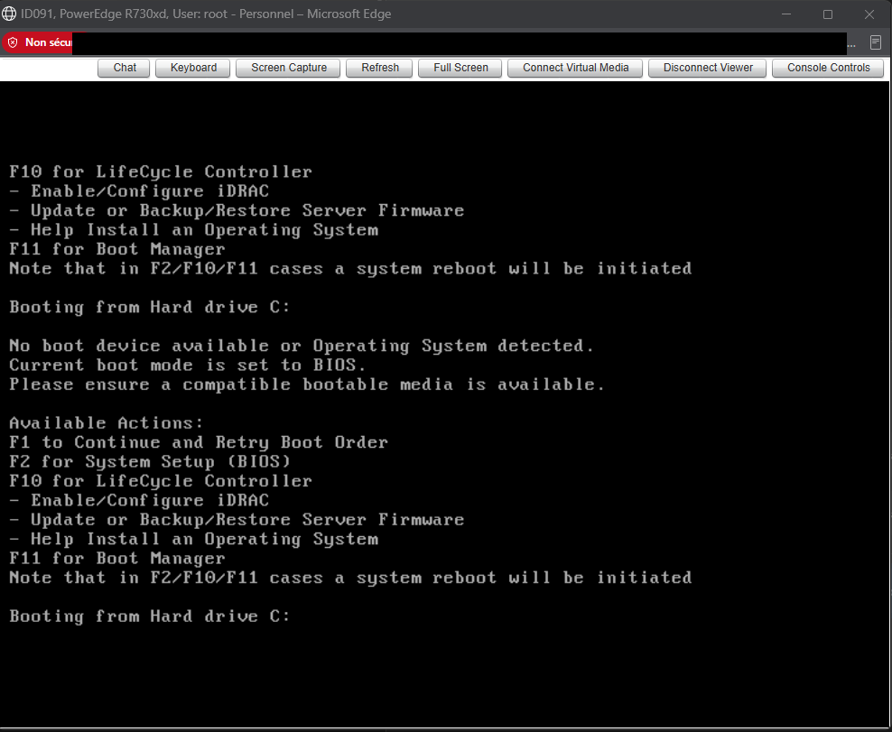

4. **Monter l'ISO d'ESXi** via *Virtual Media* : choisir le fichier, puis *Map Device*.
   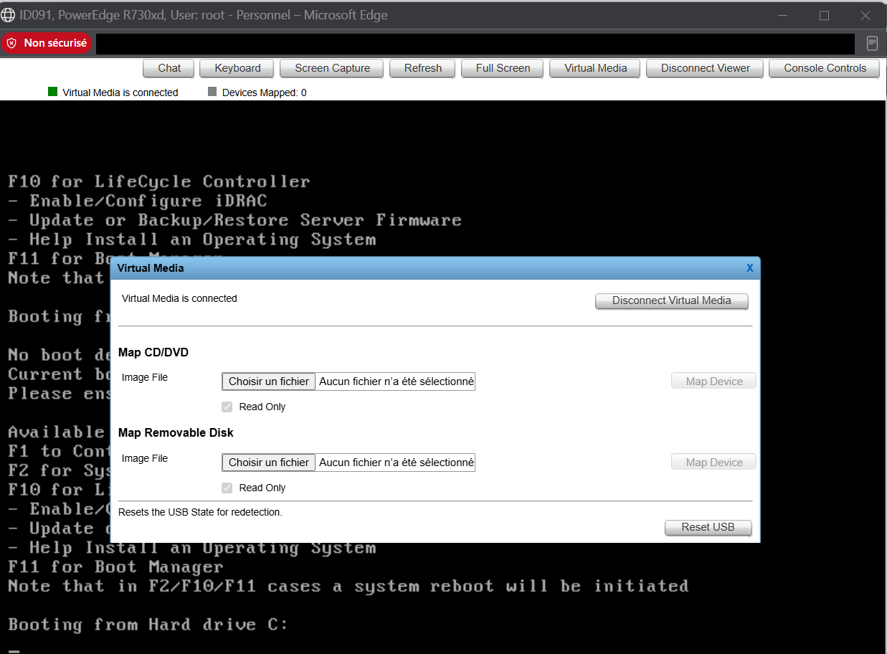
   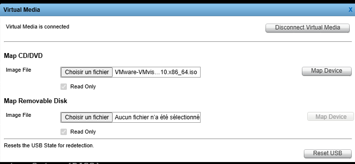
   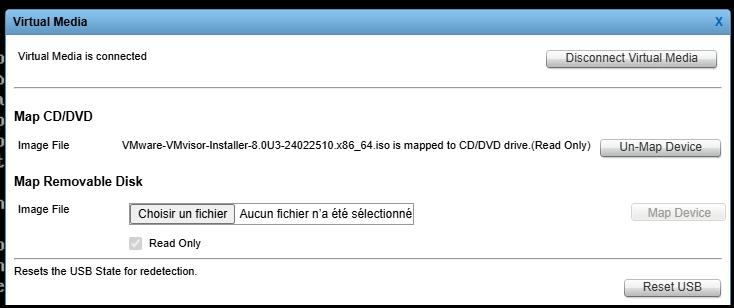
   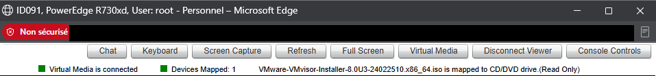

   > Le périphérique doit rester mappé jusqu'au démarrage, sinon il n'apparaît pas dans la liste de boot.

5. **Redémarrer** avec la macro *Ctrl-Alt-Del* (Console Controls).
   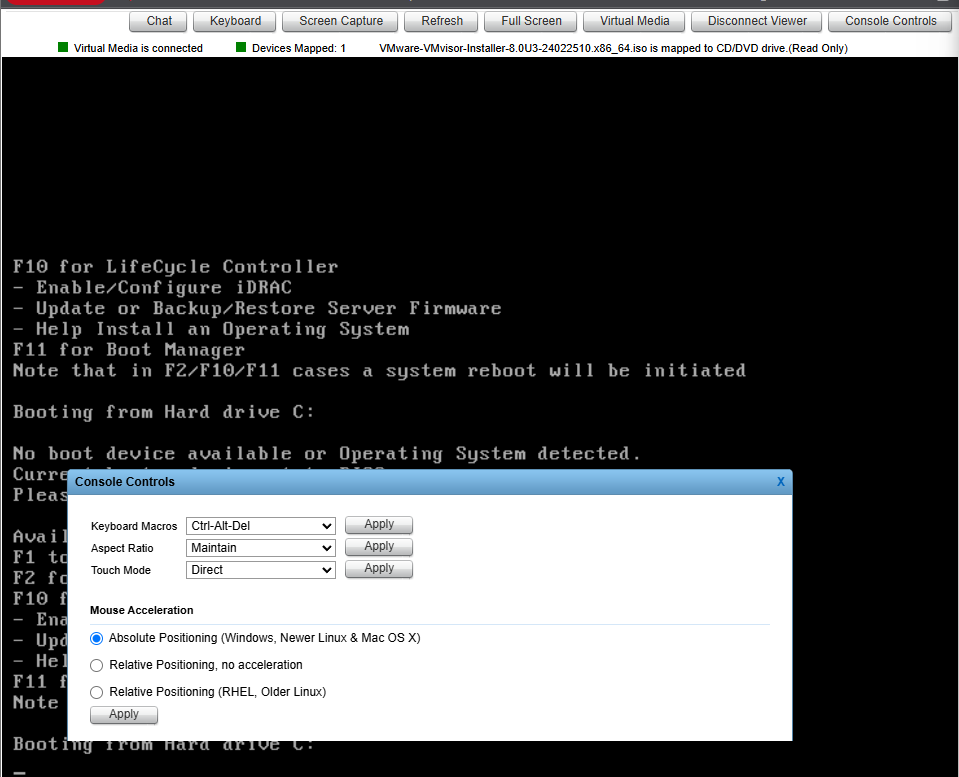

6. **F11 : Boot Manager**, puis *One-shot boot* sur **Virtual Optical Drive**. On ne modifie donc pas l'ordre de boot permanent.
   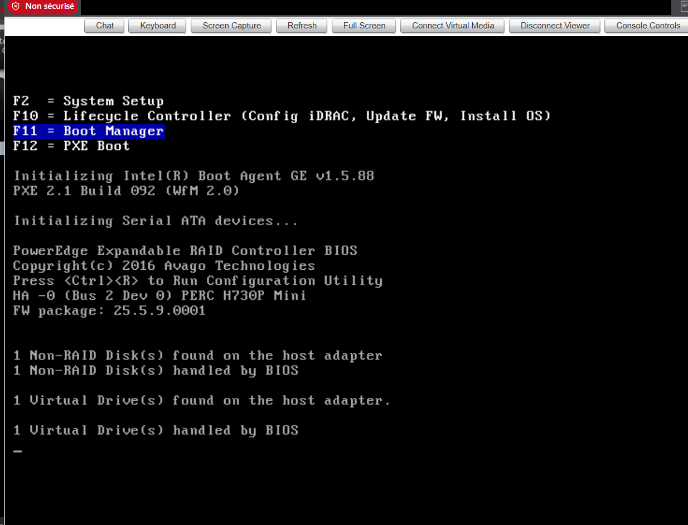
   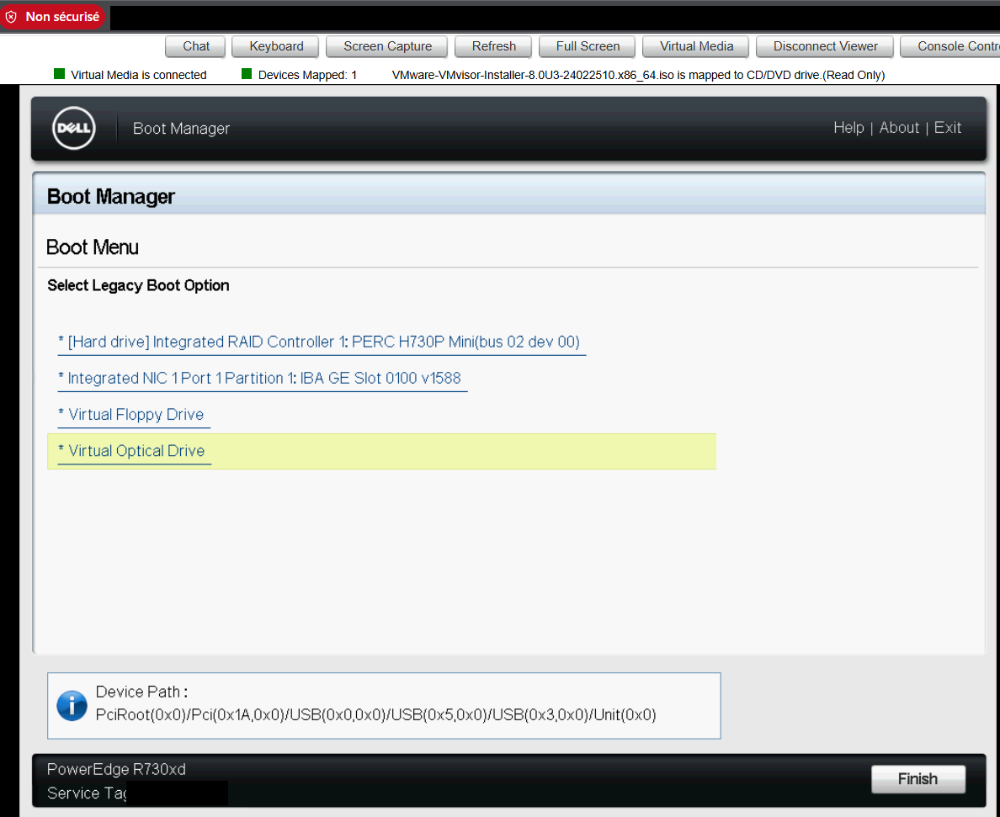

7. **L'installateur ESXi démarre** depuis l'ISO.
   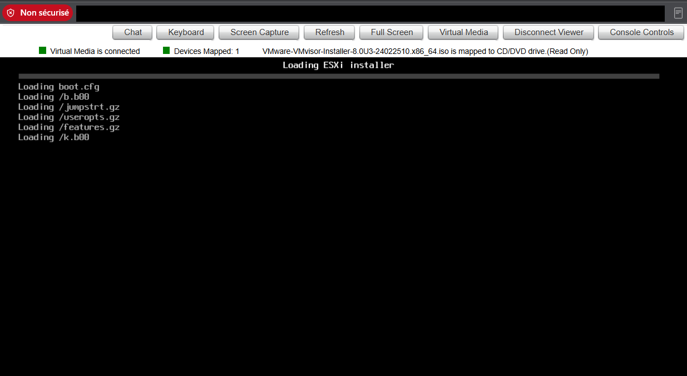
   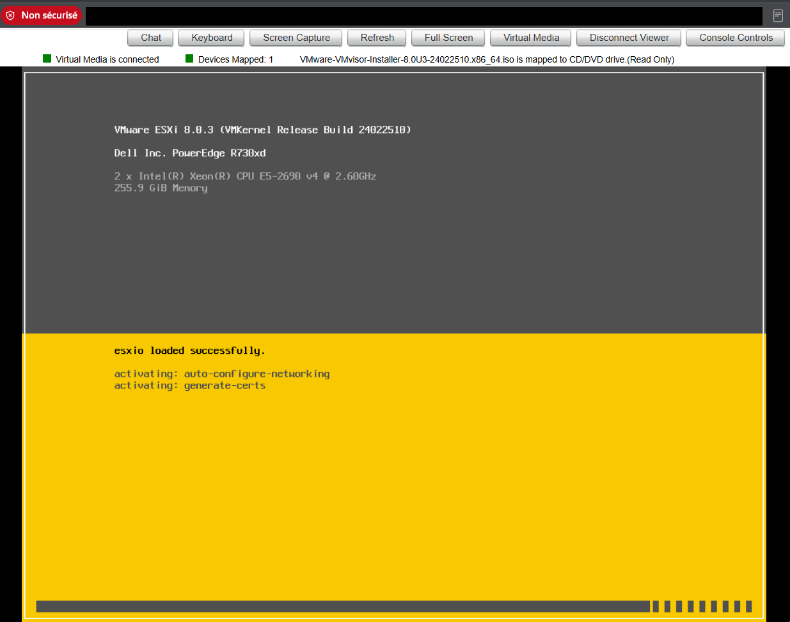

8. **Choisir le disque** d'installation (volume RAID du contrôleur PERC, 7,28 TiB), puis suivre l'assistant (clavier, mot de passe root, confirmation).
   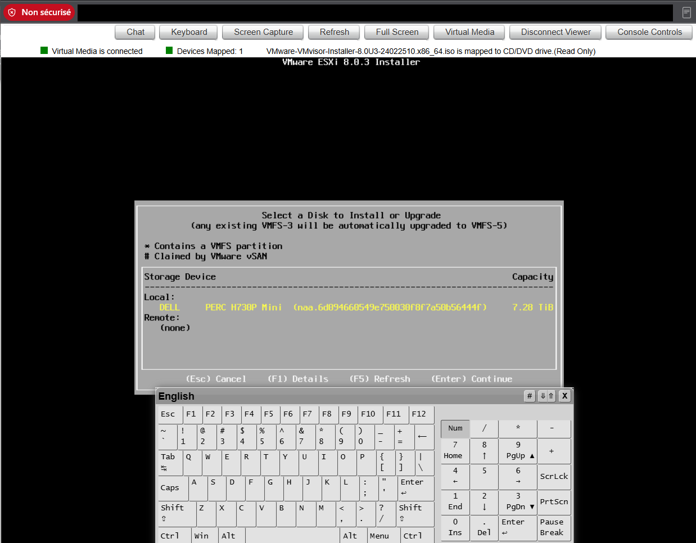

9. **Premier démarrage** : l'écran DCUI affiche l'URL de gestion. L'hôte a obtenu son adresse en DHCP.
   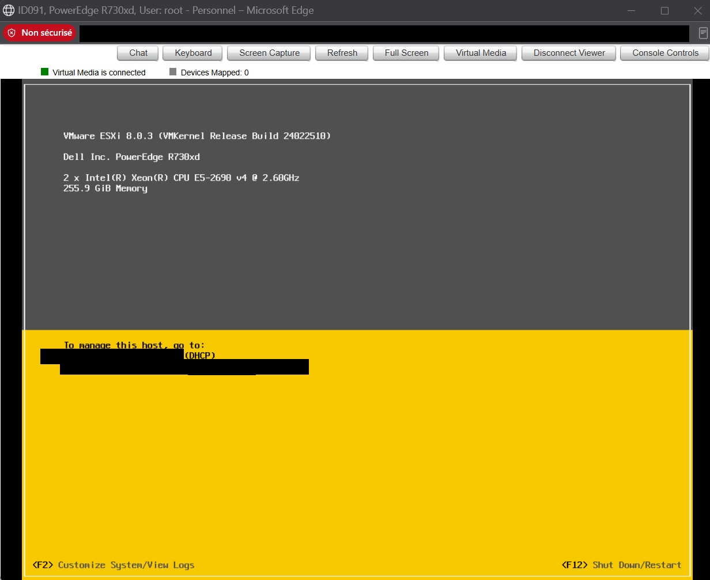

10. **Ouvrir le Host Client** dans un navigateur : l'hôte est opérationnel (ESXi 8.0 U3, mode évaluation).
    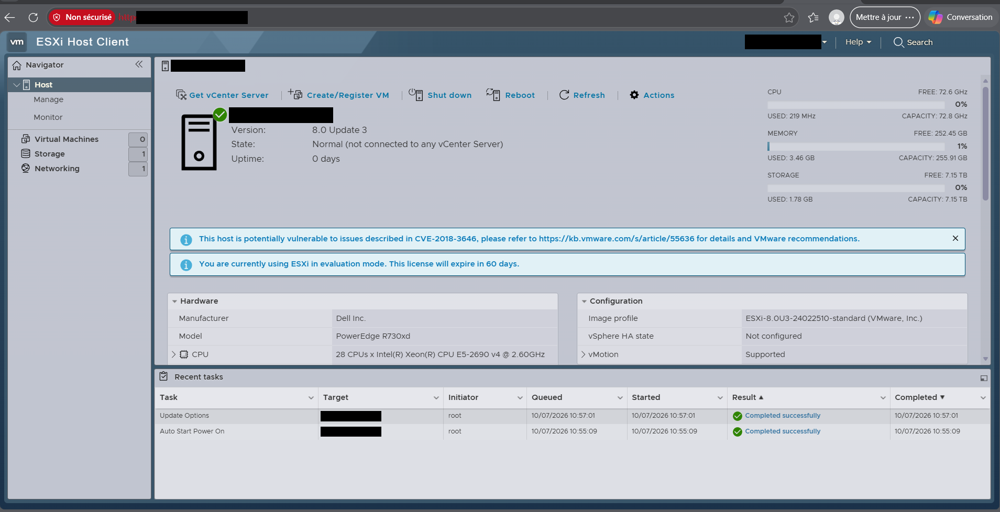

## À retenir

- L'ISO montée à distance remplace la clé USB : indispensable quand le serveur est dans une salle technique.
- Le **one-shot boot** évite de toucher au BIOS.
- ESXi tourne ici avec une seule carte réseau physique (`vmnic0`), contrainte qui structure toute la suite.
