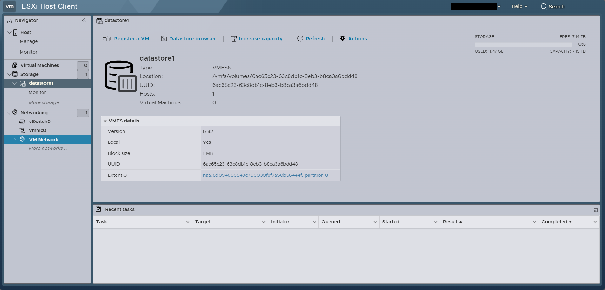
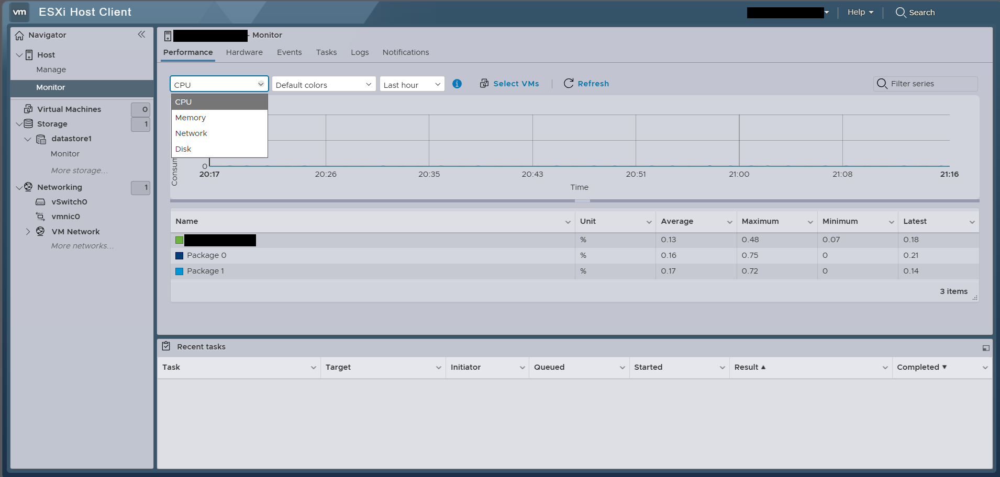

# Étape 2 : datastore et validation de l'hôte

[← Étape précédente](01-esxi-idrac.md) · [Étape suivante →](03-pfsense.md)

## Objectif

S'assurer que l'hôte est sain et que le stockage est prêt à recevoir les ISO et les machines virtuelles.

## Déroulé

1. **Datastore** : `datastore1`, VMFS6, créé automatiquement sur le disque local (≈ 7,15 To de capacité).
   

2. **Surveillance de l'hôte** : onglet *Monitor*, CPU, mémoire, réseau et disque sont consultables. Pratique pour valider que la machine est au repos avant de déployer.
   

## À retenir

- Le datastore est local : pas de stockage partagé, donc pas de vMotion ni de haute disponibilité dans ce lab.
- Les identifiants de volume (UUID) du datastore sont sans conséquence ici ; seuls l'URL, l'utilisateur connecté et le nom d'hôte ont été masqués.
