# Étape 4 : Ubuntu, Docker, Portainer et PairDrop

[← Étape précédente](03-pfsense.md) · [Étape suivante →](05-dns-et-client-windows.md)

## Objectif

Héberger un service dans un conteneur, administré depuis une interface web, avec des **données persistantes** (volume nommé, pas de bind mount) et un **réseau Docker dédié**. PairDrop, que je faisais déjà tourner avec un simple compose, est migré vers un stack Portainer.

## 4.1 La VM Ubuntu

Ubuntu Server (dernière LTS) sur `pg_LAN`. Elle obtient son adresse du DHCP de pfSense (`192.168.1.11`).

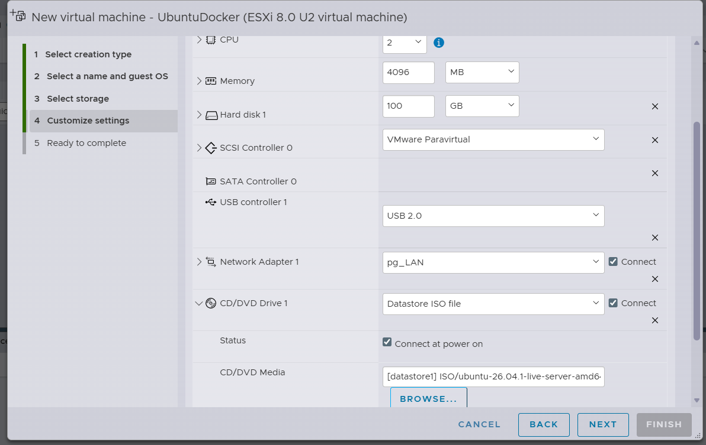
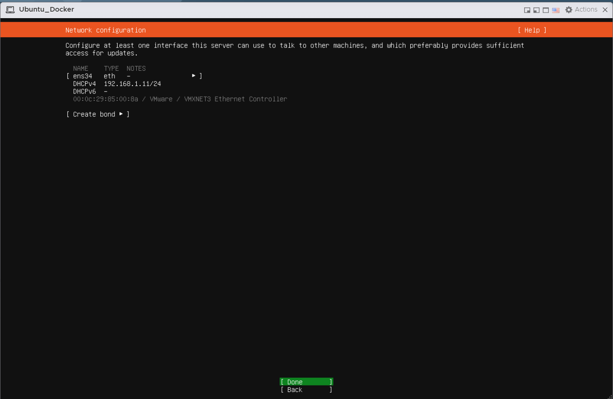
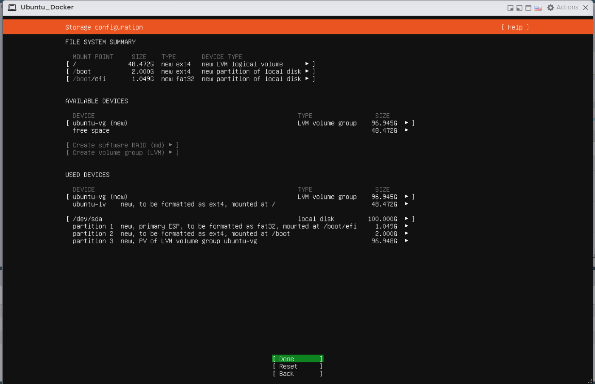
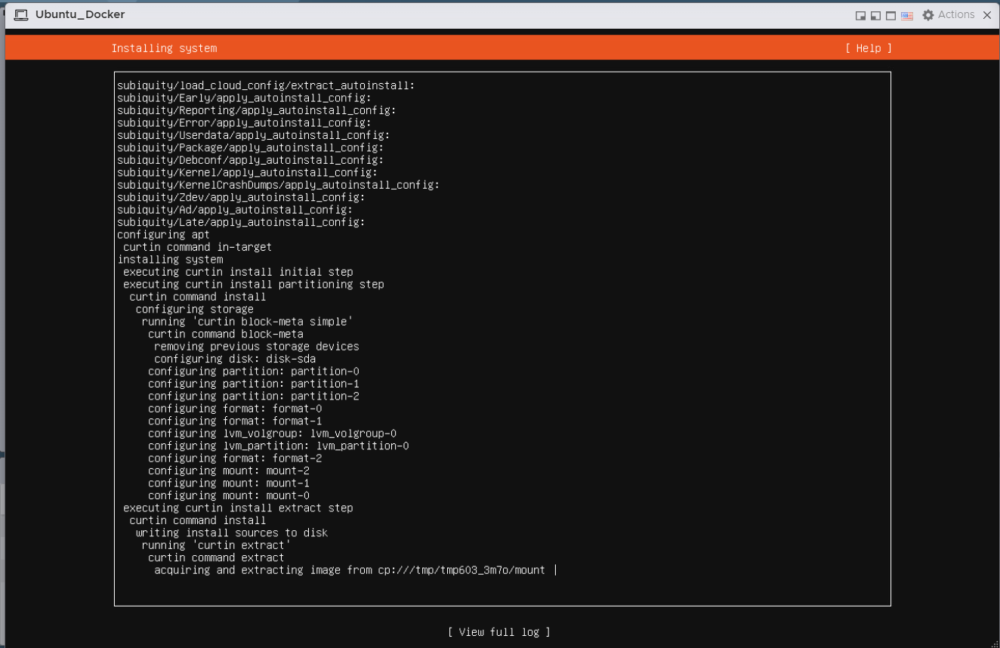

## 4.2 Docker et Docker Compose

```bash
apt install docker-compose-v2 docker.io
systemctl status docker
```

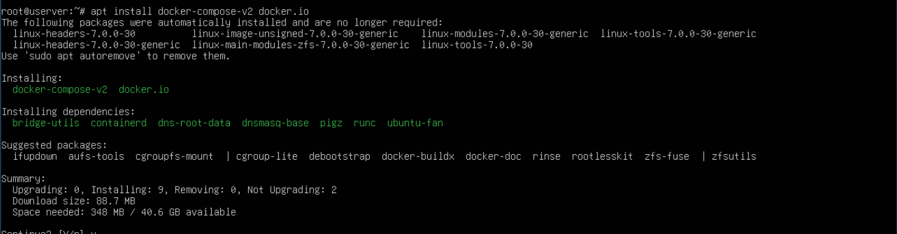
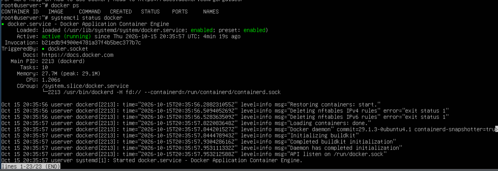

## 4.3 Portainer en ligne de commande

```bash
docker volume create portainer_data

docker run -d -p 8000:8000 -p 9443:9443 \
  --name portainer \
  --restart=always \
  -v /var/run/docker.sock:/var/run/docker.sock \
  -v portainer_data:/data \
  portainer/portainer-ce:lts \
  --no-setup-token
```

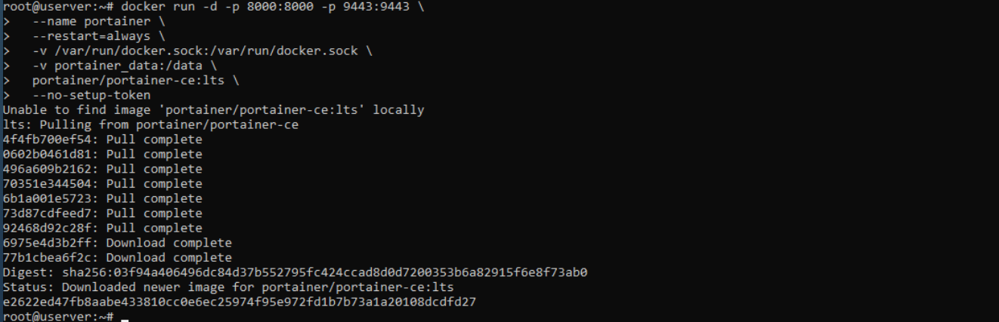

L'interface répond sur `https://192.168.1.11:9443`. Le certificat est auto-signé : l'avertissement du navigateur est normal.

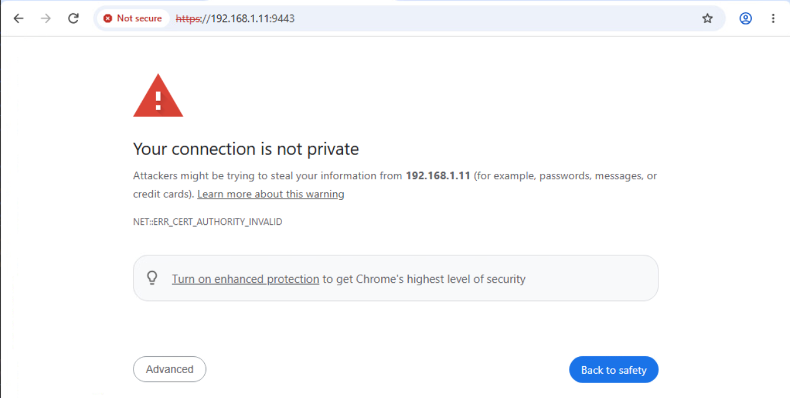

Création du compte administrateur (Portainer exige au moins 12 caractères ; le mot de passe n'apparaît pas ici).

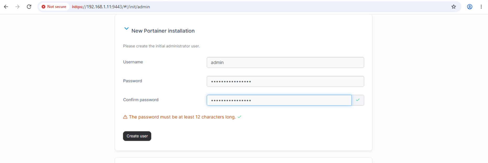

## 4.4 Réseau externe `web` et volume nommé

Dans Portainer, création du réseau `web`, puis du volume `pairdrop_data`.

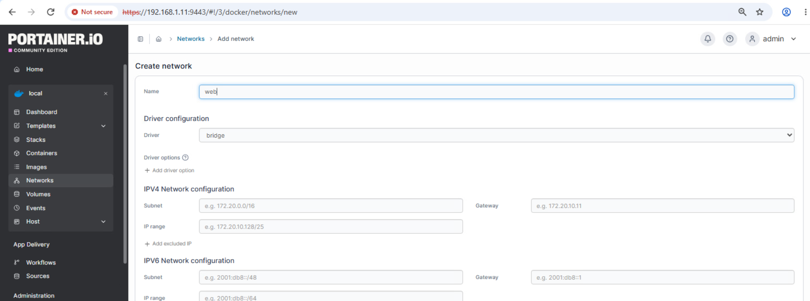
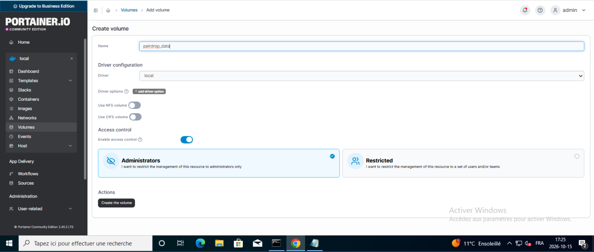
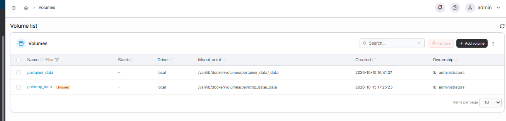

## 4.5 Migrer PairDrop vers un stack

1. Arrêter proprement l'ancien conteneur : `docker compose down` depuis son dossier d'origine ([compose d'origine](../configs/pairdrop-compose-origine.yml)).
2. Dans Portainer : *Stacks → Add stack*, nom `pairdrop`, éditeur web, avec le [compose du stack](../configs/pairdrop-stack.yml).
   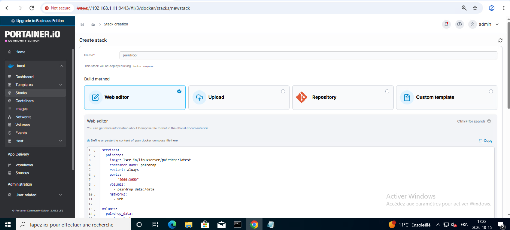
3. Déployer, puis vérifier que le conteneur est `running` et membre du réseau `web`, avec le volume `pairdrop_data` monté sur `/data`.
   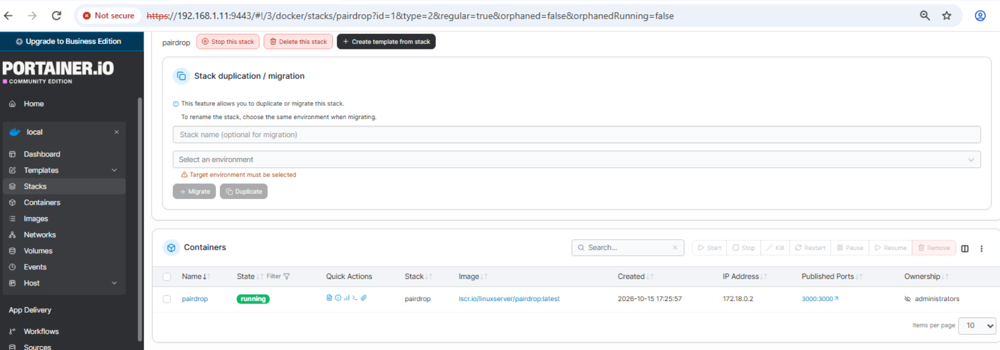
   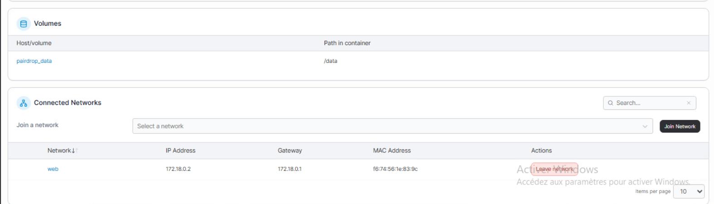
4. Valider l'accès depuis un navigateur du LAN : `http://192.168.1.11:3000`.
   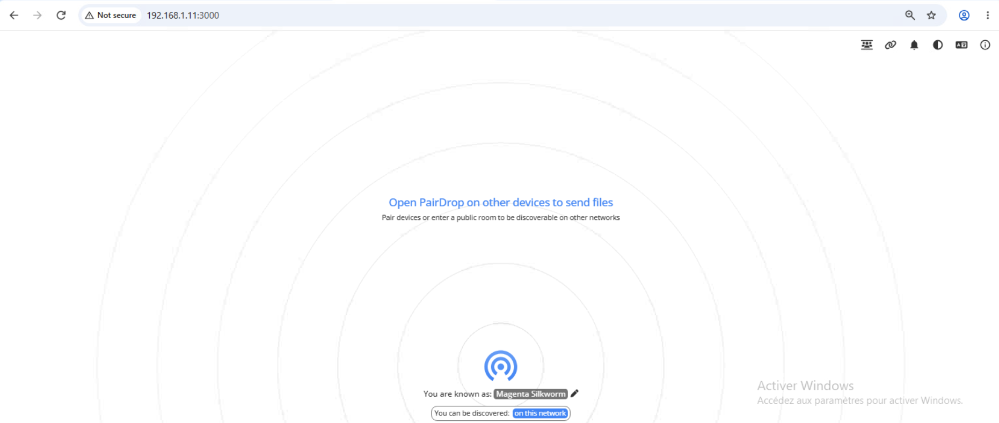

## À retenir

- `external: true` indique que le volume et le réseau existent déjà : le stack les utilise sans les créer, ni les supprimer à sa suppression.
- Aucun chemin local dans la section `volumes` du service : les données vivent dans un volume géré par Docker.
- L'adresse `172.18.x.x` visible dans Portainer est celle du réseau Docker interne, pas du lab.
