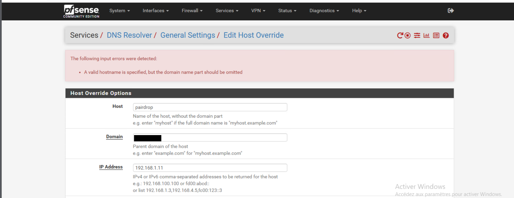
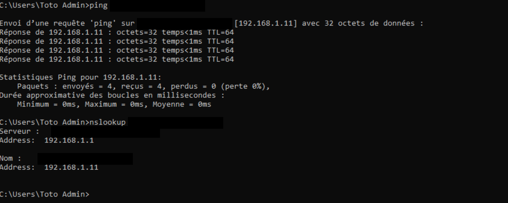
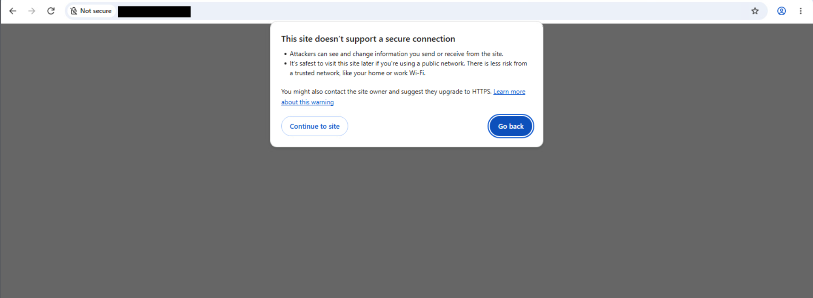
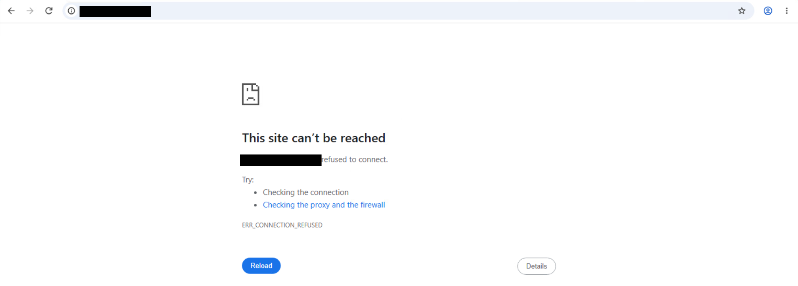
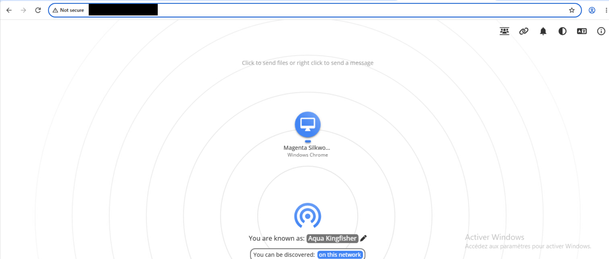

# Étape 5 : un domaine fictif résolu par pfSense

[← Étape précédente](04-ubuntu-docker-portainer.md) · [Étape suivante →](06-port-forward.md)

## Objectif

Accéder à PairDrop par un **nom** (`pairdrop.lab.example`) plutôt que par une adresse IP. Le domaine n'existe pas sur Internet : il n'est résolu que par le **DNS Resolver de pfSense**, pour les machines du LAN. C'est une pratique courante en entreprise pour nommer des services internes.

## Déroulé

1. Dans pfSense : *Services → DNS Resolver → Host Override*. Hôte `pairdrop`, domaine `lab.example`, adresse `192.168.1.11`.

   Première tentative refusée : *« A valid hostname is specified, but the domain name part should be omitted »*. Le champ *Host* ne reçoit que `pairdrop`, pas le nom complet.
   

2. **Valider la résolution** depuis le client Windows avec `ping` et `nslookup` : le nom pointe sur `192.168.1.11`, le serveur DNS interrogé est `192.168.1.1`.
   

3. **Tester dans un navigateur.** Plusieurs échecs sont normaux :
   - le navigateur tente d'abord HTTPS : le service n'en propose pas.
     
   - en HTTP sur le port 80 par défaut, rien n'écoute.
     
   - en précisant **`:3000`**, l'interface s'affiche. Le client apparaît aussi comme un autre appareil détecté.
     

## Pourquoi `:3000` est indispensable

Un enregistrement DNS associe un **nom à une adresse IP**, jamais à un port. Sans port, le navigateur utilise 80 (HTTP) ou 443 (HTTPS). Pour s'en passer, il faudrait un **reverse proxy** qui écoute sur 80/443 et redirige vers le conteneur (piste d'amélioration).
