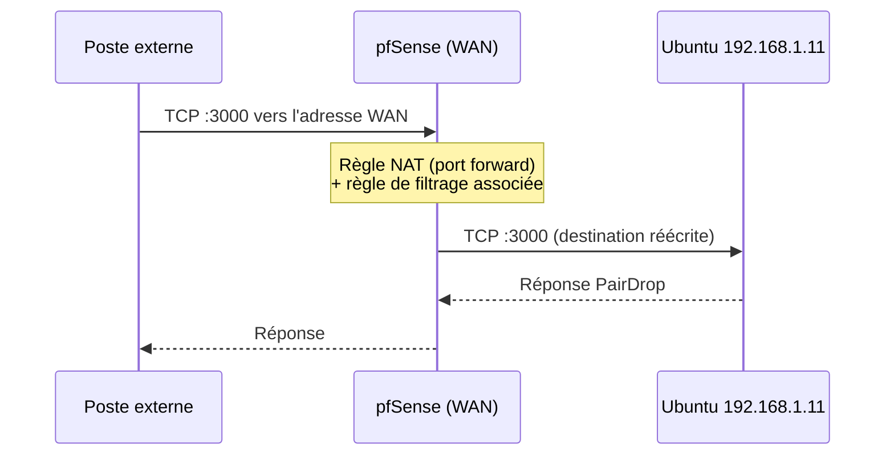
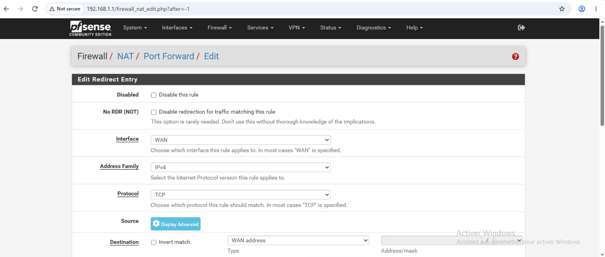
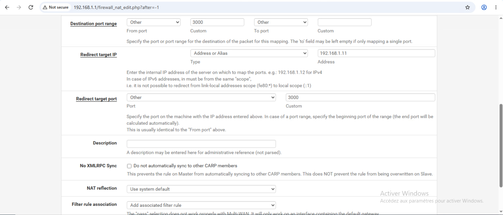
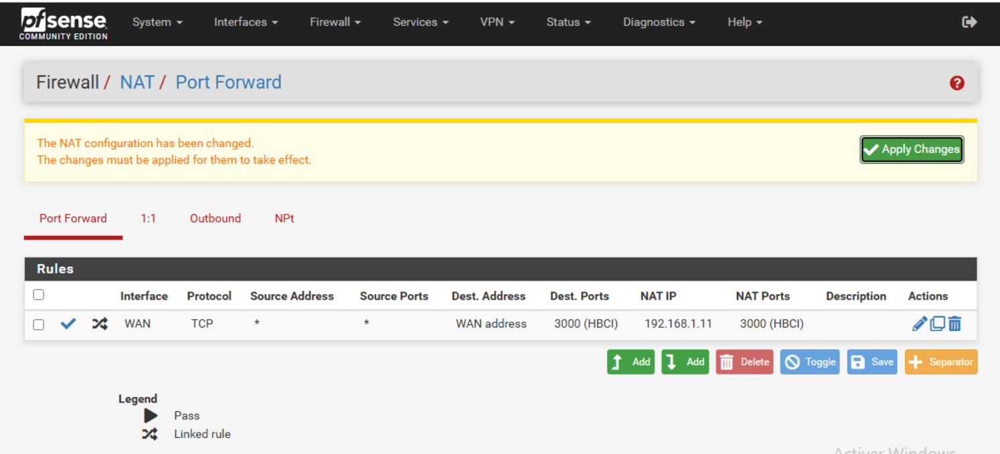

# Étape 6 : redirection de port et accès depuis le WAN

[← Étape précédente](05-dns-et-client-windows.md) · [Difficultés →](07-difficultes.md)

## Objectif

Rendre PairDrop joignable **depuis l'extérieur du LAN** : une machine d'un autre segment du réseau, qui ne connaît que l'adresse WAN de pfSense, doit atteindre le conteneur.

## Principe

## Configuration

*Firewall → NAT → Port Forward → Add*, interface **WAN** :

| Champ | Valeur |
|---|---|
| Protocole | TCP |
| Destination | WAN address |
| Port de destination | 3000 |
| Redirect target IP | 192.168.1.11 |
| Redirect target port | 3000 |
| Filter rule association | Add associated filter rule |

Après enregistrement, appliquer les changements. La règle apparaît dans la liste avec le symbole de règle liée.

## Validation

Depuis un poste d'un autre segment, ouvrir `http://<adresse WAN de pfSense>:3000` : l'interface PairDrop doit s'afficher.

Le premier essai a expiré (`ERR_CONNECTION_TIMED_OUT`) à cause du blocage des réseaux privés et bogons sur l'interface WAN : voir [Difficultés](07-difficultes.md#5-accès-refusé-depuis-un-autre-segment).

> **Capture de preuve non incluse.** La capture montrant l'accès réussi depuis le segment externe affiche l'adresse WAN réelle du réseau amont ; elle n'est donc pas publiée.
